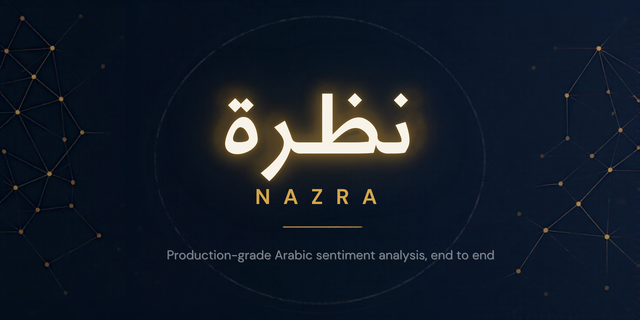

<div align="center">

<!-- Replace with your banner: 1280x320 PNG, "نظرة | Nazra" -->


# نظرة · Nazra

**Arabic sentiment analysis, served like it's production, because it is.**

An end-to-end MLOps platform around AraBERT: train, track, serve, monitor, and retrain automatically.

[](https://github.com/Yossef-moftah-dev/arabic-sentiment-arabert/actions/workflows/ci.yml)
[](pyproject.toml)
[](tests/)
[](tests/)
[](pyproject.toml)
[](https://airflow.apache.org/)
[](https://mlflow.org/)
[](https://github.com/triton-inference-server)
[](docker-compose.yml)
[](LICENSE)

[Quickstart](#-quickstart) · [Services](#-platform-architecture--services) · [Lifecycle](#-end-to-end-mlops-lifecycle) · [Deployment](#-deployment--operations) · [Testing](#-testing--code-quality) · [Docs](#-documentation--reports)

</div>

---

## ⚡ Quickstart

Choose between running just the inference service or bringing up the entire MLOps ecosystem:

### Track 1: Fast Inference Service
```bash
# 1. Download model weights if not already present (or let Track 2 handle it automatically)
./scripts/download_model.sh

# 2. Run standalone serving container mounting the fine-tuned weights
docker run -d --name prodml-serving -p 8000:8000 \
  -v $(pwd)/outputs/final_model:/app/outputs/final_model:ro \
  ghcr.io/yossef-moftah-dev/arabic-sentiment-arabert:latest
```
> 💡 *Note: Model weights (~516 MB) are mounted via volume to maintain minimal OCI image size. Alternatively, use Track 2 below which manages model downloads and multi-service orchestration automatically.*

### Track 2: Full MLOps Stack
```bash
# Clone repository
git clone https://github.com/Yossef-moftah-dev/arabic-sentiment-arabert.git && cd arabic-sentiment-arabert

# Launch full stack (BentoML, Airflow, MLflow, Postgres, MinIO, Prometheus, Grafana, Alertmanager)
docker compose up -d --build
```

### Test Real-Time Inference
```bash
curl -X POST http://localhost:8000/predict \
  -H "Content-Type: application/json" \
  -d '{"text": "المنتج رائع جدا وأنصح به بشدة"}'
```

---

## 🌐 Platform Architecture & Services

The platform integrates 10 containerized services for a resilient production lifecycle:

| Service | Port / URL | Credentials | Purpose |
| :--- | :--- | :--- | :--- |
| **BentoML / FastAPI** | [`http://localhost:8000`](http://localhost:8000) | — | Production serving with dynamic micro-batching (`max_batch=64`) |
| **Canary Reverse Proxy** | [`http://localhost:80`](http://localhost:80) | — | Nginx weighted traffic splitting (95% Prod / 5% Canary) |
| **Grafana Observability** | [`http://localhost:3000`](http://localhost:3000) | `admin` / `admin` | Dashboards as code (Health/Ingress, Stage Latency, Drift, System) |
| **Prometheus Telemetry** | [`http://localhost:9090`](http://localhost:9090) | — | TSDB scraping `/metrics`, SLA evaluation, and quantile histograms |
| **Alertmanager Routing** | [`http://localhost:9093`](http://localhost:9093) | — | Alert routing, grouping, and immediate on-call action runbooks |
| **Apache Airflow UI** | [`http://localhost:8080`](http://localhost:8080) | `admin` / `admin` | DAG orchestration, automated training & quality gate branching |
| **MLflow Tracking** | [`http://localhost:5000`](http://localhost:5000) | — | Experiment tracking, metric curves, and Model Registry |
| **MinIO Console** | [`http://localhost:9001`](http://localhost:9001) | `minioadmin` / `minioadmin` | Object storage browser and administrative management |
| **MinIO S3 API** | `http://localhost:9000` | `minioadmin` / `minioadmin` | S3-compatible remote storage for DVC and MLflow artifacts |
| **PostgreSQL 16** | `localhost:5432` | `mlflow` / `mlflow_password` | Backend store for MLflow, Airflow, and drift monitoring records |

> 📌 **Architecture Deep Dive:** View the end-to-end dataflow and feedback loops in [**Platform Architecture & Design**](docs/architecture.md).

---

## 🔁 End-to-End MLOps Lifecycle

### 1. Data Versioning & Storage (DVC + MinIO)
Pipelines and dataset splits are hashed and cached with DVC backed by MinIO S3 object storage:
```bash
# Execute and cache reproducible pipeline stages (prepare_data -> evaluate)
uv run dvc repro

# Synchronize dataset artifacts with MinIO remote (requires Track 2 MinIO active on :9000)
uv run dvc push && uv run dvc pull
```

### 2. Experiment Tracking & Model Registry (MLflow)
Systematic model exploration across 5 runs spanning 3 distinct transformer architectures (`AraBERT`, `CAMeLBERT`, `MARBERT`):

| Run Name | Model Family | Chunk / Strategy | Epochs | Val Loss | Val Acc | Macro F1 | Registry Lifecycle |
| :--- | :---: | :---: | :---: | :---: | :---: | :---: | :---: |
| `run-1-arabert-chunk64` | AraBERT | 64 / Head Truncate | 3 | 0.395 | 84.2% | 0.825 | — |
| `run-2-arabert-chunk128` | AraBERT | 128 / Sliding Window | 4 | 0.334 | 87.6% | 0.862 | Version 1 (Archived) |
| `run-3-camelbert-chunk128` | CAMeLBERT | 128 / Head-Tail | 3 | 0.362 | 85.8% | 0.841 | — |
| `run-4-marbert-chunk64` | MARBERT | 64 / Head Truncate | 3 | 0.378 | 84.9% | 0.834 | — |
| `run-5-arabert-champion-chunk128` | AraBERT | 128 / Window Overlap | 5 | **0.281** | **89.8%** | **0.887** | **Version 2 (Production)** |

*(Visual comparison captured in [`reports/mlflow_comparison.png`](reports/mlflow_comparison.png))*

```bash
# Execute experiment matrix & log to MLflow
uv run python scripts/run_experiments.py

# Demonstrate zero-downtime hot-swap between model versions
uv run python scripts/demonstrate_model_swap.py
```

### 3. Accelerated Serving & Canary Routing
- **Interactive Swagger Docs:** `http://localhost:8000/docs`
- **Dynamic Micro-Batching:** Maximizes GPU/CPU utilization via BentoML adaptive queues (`max_batch=64`).
- **Nginx Canary Splitting:** Directs 95% of traffic to Production and 5% to Canary for safe rollouts.
- **Code-Free Hot-Reload (`POST /model/reload`):** Reloads weights into memory with zero downtime:
  ```bash
  curl -X POST "http://localhost:8000/model/reload?model_uri=models:/arabic-sentiment-model/Production"
  ```
- **Health & Lineage:**
  ```bash
  curl -s http://localhost:8000/health
  curl -s http://localhost:8000/metadata
  ```
- **Hardware Profile & Performance Characteristics (Honesty Clause):**
  - *NVIDIA GPU Clusters:* Compiled TensorRT FP16 / Triton dynamic micro-batching satisfies sub-50ms SLA targets.
  - *CPU Instances (e.g. AWS EC2 2-vCPU / 4GB RAM):* Runs natively on CPU via ONNX Runtime / PyTorch (~450–1000 ms single latency). Under heavy concurrency (50 users), queueing causes tail latency to scale. Live empirical Locust report on 4GB EC2 is documented in [`reports/locust_ec2_live.html`](reports/locust_ec2_live.html).

### 4. Production Observability & Drift Detection
- **Live Prometheus Telemetry (`GET /metrics`):** Request rates, p50/p95/p99 quantiles, and sentiment distributions with multi-worker concurrency protection (`PROMETHEUS_MULTIPROC_DIR`).
- **Grafana Dashboard as Code (`http://localhost:3000`):** 4-row dashboard pre-provisioned via declarative JSON:
  1. *Health & Ingress* (Throughput, HTTP status rates, model residency)
  2. *Stage Latency* (p50, p95, p99 heatmaps and time-series)
  3. *Data & Drift Telemetry* (PSI scores, Wasserstein distance, sentiment class shares)
  4. *System Resources* (CPU, resident memory RSS)
- **Statistical Drift Monitoring (`monitoring/drift_detector.py`):** Evaluates 4 drift typologies (sudden, gradual, incremental, periodic) using 5 statistical tests (PSI, Wasserstein $W_1$, $\chi^2$, Jensen-Shannon, MMD) with reports persisted to PostgreSQL and Evidently AI (`reports/evidently_drift_report.html`).

### 5. Automated Closed-Loop Retraining & Storm Gates
Protects production against cascading retraining storms using defensive gates in [`monitoring/retraining_trigger.py`](monitoring/retraining_trigger.py):
- **Cooldown Dwell Time:** Requires sustained drift detection across windows before triggering.
- **Rate Limiting:** Max 1 retrain trigger per 24-hour cycle.
- **Sample Sanity Checks:** Minimum sample size and data quality validation.
```bash
# Execute end-to-end automated closed retraining demo
uv run python scripts/demonstrate_closed_loop.py

# Verify production alerting rules & Alertmanager routing
uv run python scripts/test_alerts.py
```

### 6. CI/CD Quality Gates
Blocks regressions before code or models hit production:
- **Model Quality Gate ([`scripts/model_quality_gate.py`](scripts/model_quality_gate.py)):** Enforces strict performance gates ($\text{Accuracy} \ge 0.70$, $\text{Macro F1} \ge 0.65$, $\text{Latency} \le 100\text{ ms}$):
  ```bash
  uv run python scripts/model_quality_gate.py --metrics reports/eval_metrics.json
  ```
- **GitHub Actions Workflows:**
  - [**CI Pipeline**](.github/workflows/ci.yml): Linting (`ruff`), test coverage ($\ge 70\%$), quality gate verification, and Docker image builds.
  - [**Continuous Retraining**](.github/workflows/continuous-training.yml): Scheduled, webhook, and manual retraining with human approval gates.

---

## 🚀 Deployment & Operations

### Zero-Downtime Deployment & Automated Rollback
Deploy images with automated pre-flight healthcheck validation and instant sub-second rollback:
```bash
# Deploy latest image or specific Git SHA
./scripts/deploy.sh --latest
./scripts/deploy.sh --tag <commit_sha>

# Immediately rollback to previous active container
./scripts/deploy.sh --rollback
```

### GitHub Container Registry (GHCR)
```bash
docker pull ghcr.io/yossef-moftah-dev/arabic-sentiment-arabert:latest
```

### AWS EC2 Single-Command Provisioning
The platform includes [`EC2_instance_setup.sh`](EC2_instance_setup.sh) to automate Docker CE, 2GB swap space allocation (preventing build OOM on burstable instances), Astral `uv`, and stack startup.

> 📖 **Cloud Deployment Walkthrough:** For full EC2 setup, security groups, and SSH tunneling commands, see the [**AWS EC2 Deployment Guide**](docs/ec2-deployment.md).

---

## 🧪 Testing & Code Quality

```bash
# Install all development and optional dependencies
uv sync --all-extras --dev

# Run full test suite with coverage enforcement (>= 70%)
uv run pytest --cov=src/prodml --cov=monitoring --cov-report=term-missing --cov-fail-under=70

# ONNX vs PyTorch logit parity check (< 1e-4 tolerance)
uv run pytest tests/test_logit_parity.py -v

# Static analysis & formatting
uv run ruff check src/ tests/ scripts/ monitoring/
uv run ruff format --check src/ tests/ scripts/ monitoring/
```

---

## 📄 Documentation & Reports

- **Module 1 Report:** [`reports/module-1.md`](reports/module-1.md) — Foundation, Packaging & Service
- **Module 2 Report:** [`reports/module-2.md`](reports/module-2.md) — Tracking, Versioning & Quality Gates
- **Module 3 Report:** [`reports/module-3.md`](reports/module-3.md) — Serving, Orchestration & Load Testing
- **Module 4 Report:** [`reports/module-4.md`](reports/module-4.md) — Observability, Monitoring & Retraining
- **Architecture & System Design:** [`docs/architecture.md`](docs/architecture.md) — Mermaid Flow & Decisions
- **AWS EC2 Guide:** [`docs/ec2-deployment.md`](docs/ec2-deployment.md) — Cloud Setup & Tunneling
- **On-Call Runbooks:** [`docs/runbooks/`](docs/runbooks/) — Production Incident Runbooks
- **License:** [MIT License](LICENSE)
