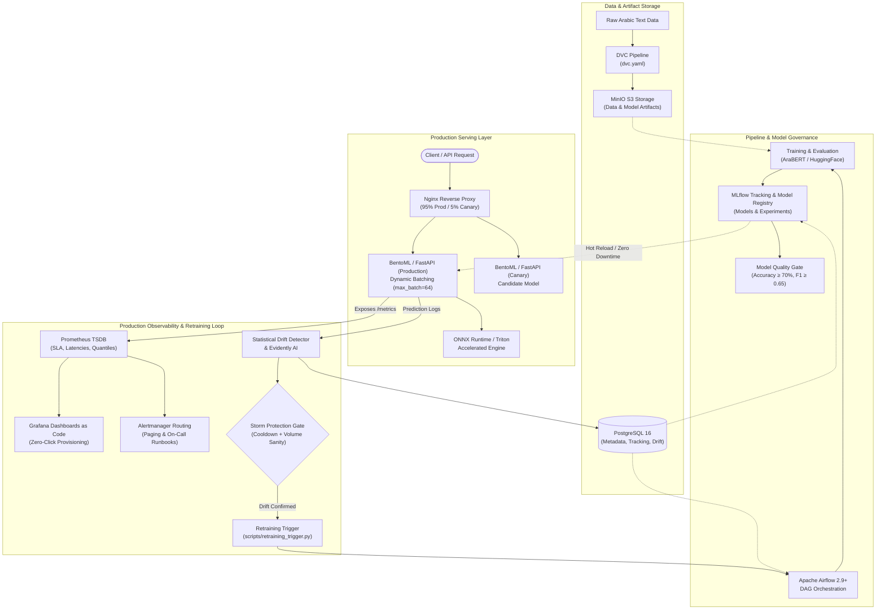

# Platform Architecture & System Design

This document details the architectural design and continuous feedback loops of the **Nazra (نظرة)** Arabic Sentiment Analysis Platform.

---

## 🏛️ End-to-End System Architecture

---

## 🔑 Key Architecture Design Decisions

### 1. Dynamic Micro-Batching & Serving Acceleration
- **BentoML & FastAPI:** Provides an asynchronous serving interface capable of dynamic batching (`max_batch=64`) to maximize hardware utilization under concurrent load.
- **ONNX Runtime / TensorRT:** Model weights are converted and benchmarked to verify logit parity ($< 10^{-4}$ tolerance) while minimizing p95 inference latency.
- **Canary Routing with Instant Fallback:** Nginx directs a configurable fraction of traffic (e.g. 5%) to a canary instance, enabling progressive validation before full rollout.

### 2. Zero-Downtime Hot-Reloading
- Model weights can be reloaded directly into memory via `POST /model/reload` querying the MLflow Model Registry, eliminating container restarts or rolling deployments for weight updates.

### 3. Closed-Loop Retraining & Defensive Storm Gates
- **Continuous Monitoring:** Real-time metrics are scraped by Prometheus, while prediction inputs are analyzed for covariate and concept drift via 5 statistical tests (PSI, Wasserstein Distance, $\chi^2$, Jensen-Shannon Divergence, and MMD).
- **Storm Protections:** To prevent cascading retraining costs or instability during transient anomalies, the trigger enforces:
  - **Dwell Time:** Requires drift to persist across multiple consecutive evaluation windows.
  - **Rate Limiting:** Maximum of 1 retraining trigger per 24 hours.
  - **Sample Volume Validation:** Ensures statistical confidence before firing triggers.
